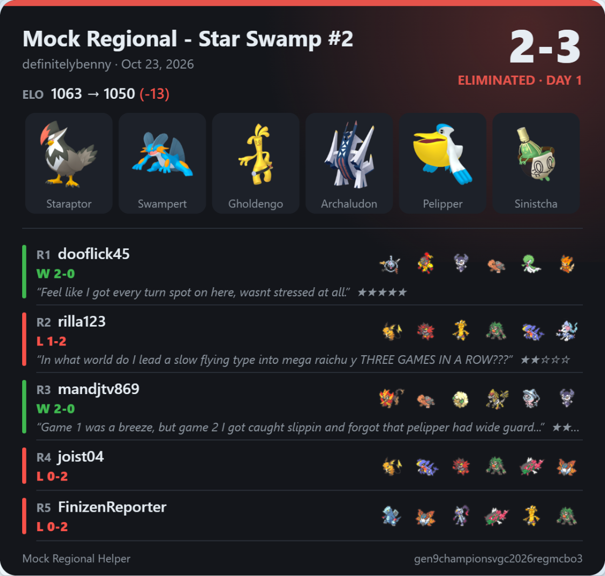
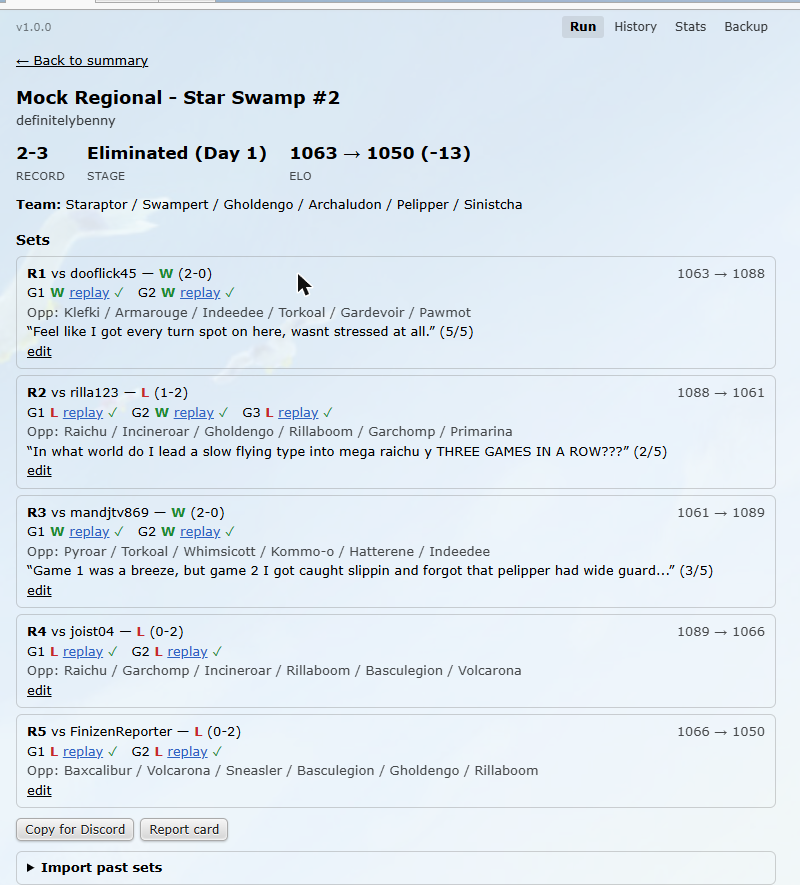
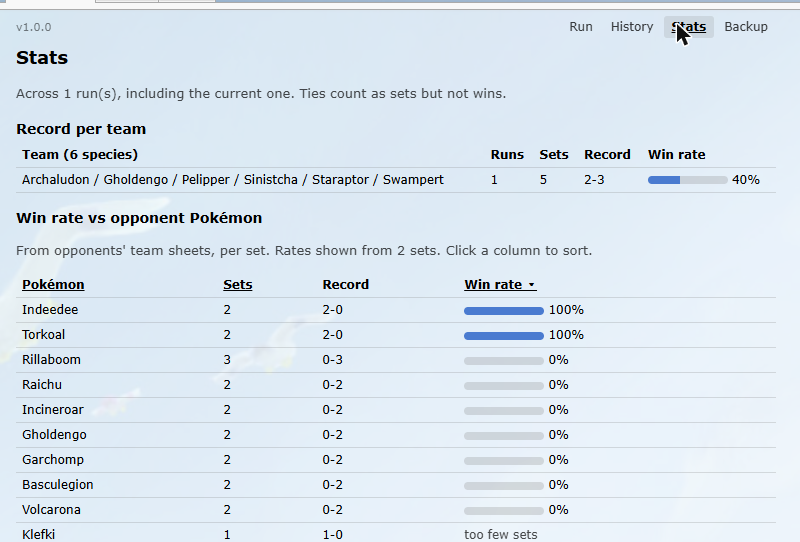

# Mock Regional Helper

[](https://github.com/definitelybenny/mock-regional-helper/releases/latest)
[](LICENSE)

Run a VGC **mock regional** on the Pokémon Showdown Bo3 ladder without the busywork. Play your sets; the script records every game, saves the replays, tracks your ELO and your Day 1 / Day 2 / Top Cut run, and builds the Discord post (or an image report card) for you.

**[Install Mock Regional Helper](https://raw.githubusercontent.com/definitelybenny/mock-regional-helper/main/mock-regional-helper.user.js)** (needs [Tampermonkey](https://www.tampermonkey.net/); see [Install](#install))

<p align="center"></p>

## Features

- **Automatic set tracking.** Every Bo3 set in the format is recorded: opponent, game-by-game results, set score, and the opponent's open team sheet.
- **Replays saved for you.** Each game's replay is uploaded and linked automatically, with a clear saved / failed indicator.
- **Run stages.** Your record decides Day 1, Day 2 (at X-2 or better), Top Cut, Eliminated or Champion. Rounds and loss limits are configurable.
- **ELO tracking.** Start and end rating for each set and for the whole run.
- **Notes.** A quick "how'd it go" note and 1-5 rating after each set.
- **Leads and bring-4.** Your leads, your four brought, and the opponent's leads for every game.
- **Discord-ready output.** Copy a formatted text post, split to fit Discord's limit, or copy/download a PNG report card.
- **History and stats.** Past runs, record per team, win rate against each opponent Pokémon and per lead pair, ELO across runs.
- **Team-switch warning.** A heads-up if you queue with a different team mid-run, so you can leave that set out.
- **Import and backup.** Add sets from replays if you started the run late, and export or import everything as a file.
- Lives in a real **Mock Regional** tab in Showdown (new and old client; works alongside Showdex).

| Run view | Stats |
|---|---|
|  |  |

It only watches the battle traffic, saves replays and formats posts. **It never picks moves, queues, or plays for you.**

## Install

1. Install the [Tampermonkey](https://www.tampermonkey.net/) browser extension (Chrome, Edge, Firefox, Safari).
   - **Chrome/Edge:** also turn on **Allow User Scripts** for Tampermonkey (right-click the Tampermonkey icon → **Manage extension** → **Allow User Scripts**), or Developer mode on older versions. Without it, scripts won't run.
2. Click **[Install Mock Regional Helper](https://raw.githubusercontent.com/definitelybenny/mock-regional-helper/main/mock-regional-helper.user.js)**. Tampermonkey opens an install page; click **Install**.
3. Open (or reload) https://play.pokemonshowdown.com/. Tampermonkey asks once for permission to contact `pokemonshowdown.com` (ELO and replays) and `pokepast.es` (team upload). Click **Always allow** for both.
4. You should see a small **Mock Regional** badge in the bottom-right corner. Click it to open the tab.

**Updates** are automatic: Tampermonkey checks this repo daily. To update right away, open the Tampermonkey dashboard → **Utilities** → **Check for userscript updates**.

## Use

1. Click the small **Mock Regional** badge to open the **Mock Regional** tab. It opens on the right side of Showdown, next to your other tabs (works in both the new and the old Showdown client). You can drag the badge anywhere; it always shows your record and stage. Enter the event name and click **Start run**.
2. Ladder as usual in `[Gen 9 Champions] VGC 2026 Reg M-C (Bo3)`. Your team is recorded when you search. If you started the run after searching, it is taken from your open team sheet in the next battle, without EVs/IVs.
   - If you search with a **different team** during a run (or one shows up in a battle's team sheet), a small alert asks whether to record that set. **Don't record** leaves it out of the run; ignoring the alert records it.
3. Each game also records your 4 brought Pokémon, your leads, and the opponent's leads and revealed Pokémon ("Led A+B (brought A, B, C, D) vs X+Y"). After each game the script saves the replay. Each game shows *saving…*, then **replay ✓**, or *failed ✗* with **Retry**. Retry only works while that battle's tab is still open. Showdown also shows its own "replay uploaded" popup. When a set ends, a note prompt appears with an optional 1-5 rating. You can skip it, and **edit** any set later.
4. **Started late?** Open **Import past sets**. Search your public replays, or paste replay links (private ones work too). Then tick the sets to add. They are inserted in date order and can replace "vs ?" placeholder sets.
5. **Adjust** has **Mark W** / **Mark L**, **Undo last set** and **End run** for anything the automation misses.
6. The run ends by itself when you are eliminated or win top cut. The tab then shows a summary with **Copy for Discord** and **New run**. Long posts are split into parts so each fits Discord's 2000-character limit, with one copy button per part. **Report card** (also on the run page and in History) draws a PNG summary: record, stage, ELO, your team, and one row per set with the opponent's six and your leads. Use **Copy image** to paste it into Discord, or **Download PNG** (copying falls back to a download if the browser blocks it). The **Show notes** toggle includes or hides your notes. **New run** moves the finished run to **History**; nothing is discarded. **Resume run** undoes a manual End run. While a run is ended, new sets are not tracked (you get a reminder if one starts).

The tab header has **History** (past runs: view read-only, copy for Discord, delete), **Stats** (record per team, win rate vs opponent Pokémon and per lead pair, ELO across runs) and **Backup** (export the current run or everything as a .json file, and import one; runs you already have are skipped).

Settings (in the tab): format ID, number of Day 1 and Day 2 rounds, max Swiss losses (default 2), top cut rounds (default 3 = Top 8), include spreads, upload to pokepast.es, and leads/bring per game in the Discord post (on by default).

Rules: you are eliminated as soon as your Swiss losses go over the max (so X-2 is still alive), or on any top cut loss. Ties count in the record but not as losses.

The run is saved in Tampermonkey storage, so reloading the page doesn't lose it.

## Troubleshooting

- **No badge or tab:** make sure Tampermonkey is enabled for the site, and on Chrome/Edge that **Allow User Scripts** is on. Then reload Showdown.
- **Sets not being recorded:** check that a run is active (not ended; use **Resume run**) and that you're playing the format set in Settings.
- **Anything else:** [open an issue](https://github.com/definitelybenny/mock-regional-helper/issues/new/choose). Include the lines from the browser console (F12 → Console, filter for `MockRegional`); they show what the script saw and why.

## Privacy

Everything the script records stays in your browser (Tampermonkey storage). There's no server and no account. The only things that leave your machine:

- **Pokémon Showdown:** saving replays (the same as clicking "Upload and share replay"), and reading your public ladder rating and replays.
- **pokepast.es:** your team is uploaded to make a paste link for the Discord post. Turn this off in Settings (**Upload team to pokepast.es**) if you'd rather not.

Nothing is posted to Discord for you. You copy and paste it yourself.

## Disclaimer

Not affiliated with or endorsed by Pokémon Showdown, Smogon, Nintendo, Game Freak, The Pokémon Company or Play! Pokémon. Pokémon names and sprites belong to their respective owners. The script never automates gameplay. It only reads battle messages and saves replays you could save yourself.

## License

[MIT](LICENSE)

## Battle data export (schema v1)

*For tool developers; regular players can skip this.*

**Backup → Export battle data** (or **Export battle data** on an archived run) writes one `.json` file. It contains the raw evidence only. Spreads are not inferred: opponent team sheets have no EVs, and damage, speed and roll inference is left to the importer.

```
{
  schema: "mock-regional-helper/battle-data", schemaVersion: 1,
  format: "gen9championsvgc2026regmcbo3", exportedAt: ISO date, player: "name",
  runs: [{
    id, event, player, startedAt: ISO date,
    myTeamPaste: Showdown export text (Level: 50; "EVs:" holds Champions stat points when known),
    myTeamHasSpreads: true if captured from your search (false = from a team sheet, no spreads),
    sets: [{
      round: "R1".."R12" | "Top 8" | "Top 4" | "Finals", opponent, result: "W"|"L"|"T"|null,
      oppTeamSheet: [{ species, item, ability, moves[], nature, gender, level, teraType? }] | null,
      oppTeamPacked: the raw packed |showteam| string, oppTeamPaste: export text (Level: 50, no EVs line),
      oppSpecies: [6 species],
      games: [{
        n, roomid, result, replayUrl,
        myLeads[2], myBring[<=4], oppLeads[2], oppRevealed[],   // Mega forms are given as the base species
        logSource: "player" | "spectator" | "replay" | null,   // spectator/replay = taken from a saved replay
        logMissing: true | false,                               // no log could be found or fetched
        log: [every protocol line of the battle room, in order], // |move|, |-damage| (HP %), |-crit|, |turn|, ...
        requests: [your |request| JSON: the team-preview one and the first in-battle one (exact stats)]
      }]
    }]
  }]
}
```

Notes for the importer:
- **Player logs** are from your own point of view. Your HP shows as exact values (`153/175`) and the opponent's as a percentage.
- **Spectator logs** show both sides as percentages and have no `requests`.
- **Missing log:** `log` is empty and `logMissing` is true if the game has no log (a manual set, or a replay that couldn't be fetched).
- **Backfill:** the export first fills missing logs, team sheets and leads from the games' replays (fetched 3 at a time and cached), so runs recorded by older versions export complete. **Backup → Battle logs → Backfill from replays** does the same without exporting.
- **Bring for replay-sourced games:** `myBring` comes from switch-ins. A Pokémon that was brought but never sent in is missing.
